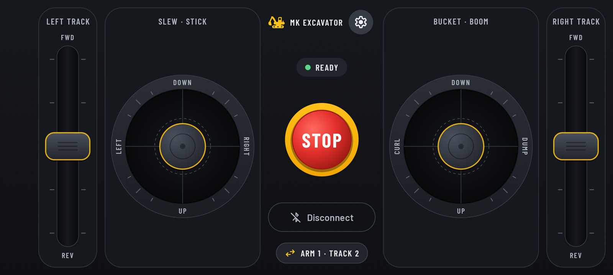
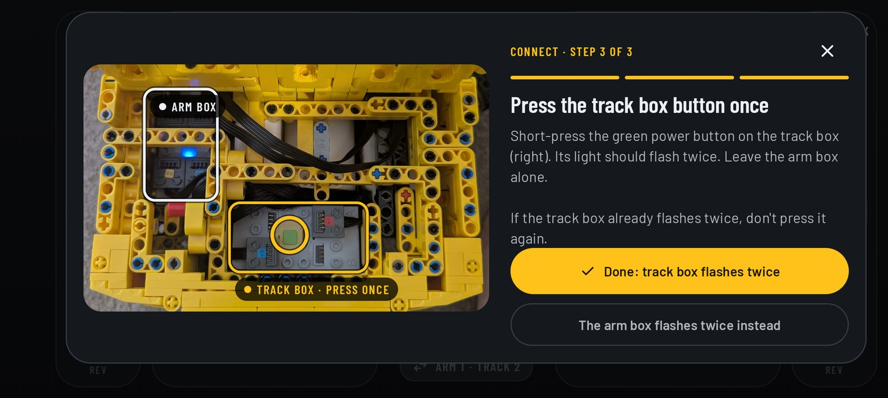
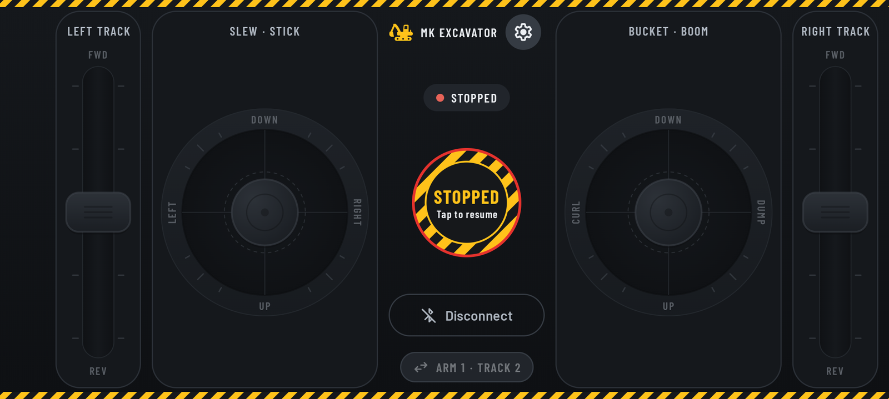
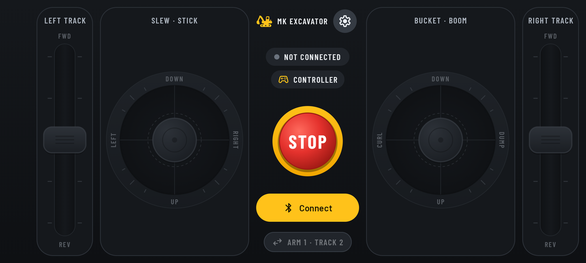
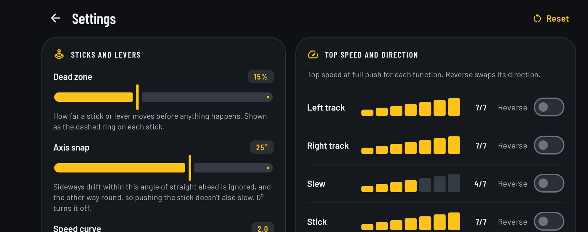

<p align="center">
  
</p>

<h1 align="center">MK Excavator</h1>

<p align="center">
  Drive the <b>Mould King 13112 RC excavator</b> from one Android screen:<br>
  both tracks, slew, stick, boom and bucket, all at the same time.
</p>

<p align="center">
  <a href="https://github.com/arcofs/mk-excavator-app/releases/latest"><b>⬇ Download the latest APK</b></a>
</p>



## Why this app

The Mould King 13112 excavator has **two battery boxes** with Bluetooth (Mould King's "4.0"
modules): one runs the arm (slew, stick, boom and bucket), the other runs the two tracks. The
official MK Tech app only drives one box at a time, so you keep switching between driving and
digging.

MK Excavator drives **both boxes at once**, laid out like the controls of a real excavator, so
you can track, slew and dig together.

## Features

- **Both boxes at once**: two track levers and two joysticks on one screen. Use any of them
  together.
- **Real-excavator layout**: the left joystick slews and moves the stick, the right joystick works
  the bucket and boom, and pushing forward lowers the arm, like the ISO controls on a real machine.
- **Proportional speed**: the further you push, the faster it goes. The rim of each control says
  what each direction does, and lights up while it's driving.
- **Latching STOP**: one tap stops everything and stays stopped until you tap again.
- **Step-by-step connect guide**: a photo of the boxes shows which button to press.
- **Adjustable feel**: dead zone, axis snap (so pushing the stick doesn't also slew), speed curve,
  and a top speed and Reverse switch for each function.
- **Xbox controller support**: drive with a Bluetooth game controller instead of the screen.
- **No internet, no account, no ads, no tracking**: the only permission is Bluetooth
  ("Nearby devices").

## What you need

- A **Mould King 13112** excavator with its two 4.0 battery boxes. The app is built around this
  model's wiring; other Mould King sets aren't supported.
- An **Android 12 or newer** phone or tablet with Bluetooth.
- Optional: an **Xbox Wireless Controller** with Bluetooth (any Xbox Series X|S controller, or an
  Xbox One controller from 2016 on). Other Bluetooth gamepads should work too, but only the Xbox
  controller has been tested.

## Install

1. On your phone, open the [latest release](https://github.com/arcofs/mk-excavator-app/releases/latest)
   and download **MK-Excavator-*version*.apk**.
2. Open the downloaded file. Android asks whether to allow your browser (or Files app) to install
   apps: tap **Settings**, turn on **Allow from this source**, then go back.
3. Tap **Install**. Google Play Protect may warn that it doesn't recognise the app (it does that
   for any app not from the Play Store); choose to install anyway.

**Updating:** download the newer APK and install it over the old one. Your settings are kept.

## First drive

1. **Switch on both boxes.** Open the lid at the back of the excavator and press the power button
   on each grey box.
2. **Open MK Excavator and tap Connect.** The first time, allow the **Nearby devices** permission.
   The app uses it to send the Bluetooth signal to the boxes.
3. **Follow the guide.** Tap **Connect** again, wait a couple of seconds, then **short-press the
   track box's power button once**, so its light flashes twice (module 2). Tap **Done**.
   - Pressed the arm box by mistake? Tap **The arm box flashes twice instead**.
   - The boxes forget this when switched off, so the guide runs on every power-up.

   
4. **Drive.**

| Control | Does |
|---|---|
| Left lever | Left track, forward and reverse |
| Left joystick, sideways | Slew left and right |
| Left joystick, forward and back | Stick: push to lower, pull to raise |
| Right joystick, sideways | Bucket: curl and dump |
| Right joystick, forward and back | Boom: push to lower, pull to raise |
| Right lever | Right track, forward and reverse |

The **Arm 1 · Track 2** button swaps the boxes if the arm and tracks ever come out the wrong way
round.

## STOP and safety



- **STOP** stops every motor and latches: the button turns to hazard stripes and hazard tape runs
  along the screen. Tap it again to resume.
- A control you were still holding when you pressed STOP has to be let go and pushed again
  before it works, so nothing lurches back into motion.
- Letting go of a control stops that motor.
- Switching apps or locking the screen stops everything and disconnects.
- If the signal is lost (the app closes, or the phone goes out of range) the boxes stop their
  motors by themselves.

## Xbox controller



1. *(Recommended)* Update the controller with the **Xbox Accessories** app on Windows or Xbox.
2. On the phone, open the Bluetooth settings and choose **Pair new device** (on a Pixel:
   Settings → Connected devices).
3. Turn the controller on, hold the small **pair button** on its top edge until the Xbox logo
   flashes fast, then tap **Xbox Wireless Controller**.
4. Open MK Excavator. A **Controller** chip appears under the status.

| Controller | Does |
|---|---|
| Left stick | Slew (sideways) and stick (push to lower) |
| Right stick | Bucket (sideways) and boom (push to lower) |
| LT / RT | Left / right track forward; squeeze harder to go faster |
| LB / RB | Left / right track reverse, at full speed |
| B | STOP (latches) |
| ☰ Menu | Resume after STOP |

- While a controller is connected the on-screen sticks follow it and ignore touch. The on-screen
  STOP still works.
- Pressing a bumper and its trigger together stops that track.
- Only ☰ resumes after B, so a double press can't undo a stop.
- If the controller disconnects or its battery runs out, everything stops.

## Settings



Tap the gear on the drive screen.

- **Dead zone**: how far a stick moves before anything happens. It shows as the dashed ring on
  each stick.
- **Axis snap**: sideways drift within this angle of straight ahead is ignored, so pushing the
  stick doesn't also slew.
- **Speed curve**: higher gives finer control at slow speeds. Full push is always top speed.
- **Top speed and Reverse**: per function. Tap the bars to set a top speed, and use Reverse if
  something moves the wrong way.
- **Test bench**: run each motor on its own, to check the wiring.

Changes are saved on the phone and apply straight away.

## Troubleshooting

- **Nothing moves after connecting.** Check both boxes are switched on and that you finished the
  guide (tapped **Done**). Make sure Bluetooth is on.
- **Arm controls move the tracks (or the other way round).** The other box got the button press.
  Tap **Arm 1 · Track 2** to swap.
- **One control moves two things.** Both boxes are on module 1. Short-press the track box's button
  once (two flashes), or switch both boxes off and on and run the guide again.
- **Something moves the wrong way.** Settings → turn on **Reverse** for that function.
- **Too fast or twitchy.** Lower that function's top speed, or raise the speed curve.
- **Controller not detected.** Pair it in Android's Bluetooth settings first, then open the app.
  If it misbehaves, update its firmware with the Xbox Accessories app.
- **"App not installed" when updating.** Uninstall the old copy first. This happens if it came from
  somewhere other than this page.

## How it works

The Mould King 4.0 boxes don't hold a Bluetooth connection: they listen for Bluetooth
*advertisements*, and each broadcast carries speeds for up to three modules. MK Excavator sends one
broadcast that fills in two modules, the arm box and the track box, so both run from the same
signal. The message format was worked out from recordings of the official app and is written up in
[docs/protocol.md](docs/protocol.md), with unit tests that reproduce the recorded messages exactly.

## Build from source

Needs Android Studio (or JDK 17+ and the Android SDK with API 37).

```bash
./gradlew assembleDebug                                 # build the debug APK
./gradlew installDebug                                  # install on a phone with USB debugging on
./gradlew testDebugUnitTest :protocol:test lintDebug    # the checks CI runs
```

On Windows use `.\gradlew.bat` instead of `./gradlew`. Development builds install as
**MK Excavator Dev** (`io.github.arcofs.mkexcavator.debug`), next to the released app.

### Release build

```bash
./gradlew assembleRelease   # app/build/outputs/apk/release/app-release.apk
```

Releases on this page are signed with the maintainer's key, which isn't in the repo. To sign your
own build, put a `release.jks` and a `keystore.properties` in `~/keystores/mk-excavator/` (or
point the Gradle property `mkexcavator.signing` at the properties file):

```properties
storeFile=/path/to/release.jks
storePassword=...
keyAlias=...
keyPassword=...
```

Without it the release build still works but comes out unsigned. Keep the key backed up: updates
only install over an app signed with the same key. Raise `versionCode` and `versionName` in
`app/build.gradle.kts` for each release.

### Project layout

| Folder | What's in it |
|---|---|
| `app/` | The Android app: Compose UI, Bluetooth broadcaster, game controller, settings |
| `protocol/` | Pure Kotlin, no Android code: builds the Mould King messages, tested on the PC |
| `docs/` | Protocol notes, roadmap and screenshots |
| `tools/` | PC helpers. `ble_sniff.py` prints the Mould King broadcasts it hears (needs `pip install -r tools/requirements.txt`); `derive_checksum.py` shows how the checksum was found |

## Credits

- [Barlow](https://github.com/jpt/barlow) typeface, SIL Open Font License 1.1.
- Icons from [Material Symbols](https://github.com/google/material-design-icons), Apache License 2.0.
- The excavator icon was drawn for this app.

Both licence texts ship in the app, in `app/src/main/assets/licenses/`.

## Disclaimer

Independent hobby project, not affiliated with or endorsed by Mould King. "Mould King" and
"MK Tech" are named only to say what this app works with. Use at your own risk, and keep fingers
and pets clear of the moving parts.
